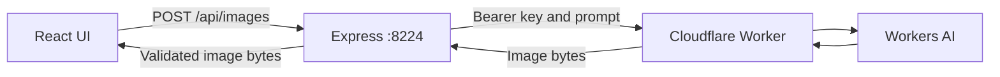

# Plan: Image Generation App

- Date: 2026-10-29.
- Status: implementation plan. Application code is not built yet.
- Basis: [INSIGHTS.md](./INSIGHTS.md) and the supplied endpoint configuration.
- Style: short modules, clear responsibilities, and typed contracts.

## 1. Goal and scope

| Area | Requirement |
| --- | --- |
| Frontend | Vite, React, TypeScript, and shadcn/ui. |
| Backend | Node.js, Express, and TypeScript. |
| Generation | Backend calls the existing Cloudflare Worker. |
| API documentation | Host OpenAPI documentation and Swagger UI. |
| Production hosting | Express serves the Vite `dist` build. |
| Backend port | `8224`. |
| Initial access | Local use. Bind to `127.0.0.1` by default. |
| Image history | Browser memory for the current session. |
| Downloads | Download each generated image with the correct extension. |

- Implement the app under `codes/v1/image_generation_app/`.
- Keep server configuration in `codes/v1/image_generation_app/.env`.
- Keep the reference project unchanged.
- Defer accounts, persistent history, model selection, and batch generation.
- Public hosting requires an application access-control decision first.

## 2. Starting point and assumptions

| Item | Observed state | Planning decision |
| --- | --- | --- |
| App folder | `codes/v1/image_generation_app/` contains `.env` and `.env.example` only. | Build the application here. Preserve the existing configuration. |
| Existing variable | `CLOUDFLARE_WORKER_AI_API`. | Use as the bearer key. The example value is `API_KEY_HERE`. |
| Worker URL | No URL variable is defined. | Add `CLOUDFLARE_WORKER_URL` before live integration. |
| Upstream API | The reference accepts `POST /` with `{ "prompt": "..." }`. | Use this contract until the supplied deployment is verified. |
| Upstream model | Fixed by the deployed Worker. | Do not expose a model selector. |
| Output | The reference labels its response `image/jpeg`. | Verify bytes. Do not trust that header alone. |

- The deployed Worker's behavior is unverified.
- Do not infer a Worker URL from the API key.
- Never copy secret values into this plan, API docs, or frontend code.

## 3. Architecture



| Mode | Browser entry | API routing |
| --- | --- | --- |
| Development | Vite on `127.0.0.1:5173`. | Proxy `/api` to `127.0.0.1:8224`. |
| Production | Express on `127.0.0.1:8224`. | Same-origin API, documentation, and static assets. |

- The browser calls relative `/api` URLs.
- Only Express knows the Worker URL and bearer key.
- The browser never calls Cloudflare directly.
- Server-to-server calls avoid the reference Worker's browser CORS limitation.
- Vite supports a development proxy. [Vite server options](https://vite.dev/config/server-options).

## 4. Configuration

| Variable | Purpose | Proposed default |
| --- | --- | --- |
| `CLOUDFLARE_WORKER_AI_API` | Existing upstream bearer key. | Required. No default. |
| `CLOUDFLARE_WORKER_URL` | Full HTTPS Worker endpoint. | Required. No default. |
| `HOST` | Express bind address. | `127.0.0.1`. |
| `PORT` | Express port. | `8224`. |
| `GENERATION_TIMEOUT_MS` | Upstream deadline, including body reading. | `60000`. |

- Load the app root `.env` through a path resolved from the server module.
- Do not depend on the shell's current directory.
- Let process environment values override file values.
- Fail startup for missing, empty, or placeholder credentials and URL.
- Require an HTTPS URL without embedded credentials.
- Keep the existing key variable name for compatibility.
- Add only placeholders to `.env.example`.
- Ignore real environment files and generated builds in Git.
- Keep the app root `.env` outside Vite's frontend root and static directory.
- Never use a `VITE_` prefix for credentials. Vite bundles such values into client code. [Vite environment documentation](https://vite.dev/guide/env-and-mode).

## 5. Backend API

| Method | Route | Purpose | Success response |
| --- | --- | --- | --- |
| `GET` | `/api/health` | Report application status. No AI call. | `200`, JSON status. |
| `POST` | `/api/images` | Generate one image from a prompt. | `200`, binary PNG, JPEG, or WebP. |
| `GET` | `/api/openapi.json` | Serve the API specification. | `200`, OpenAPI JSON. |
| `GET` | `/api/docs` | Serve Swagger UI. | `200`, documentation page. |

- Request body: `{ "prompt": "A small robot painting a sunset" }`.
- Require `Content-Type: application/json` for generation.
- Require a JSON object with a string `prompt`.
- Trim the prompt. Accept 1–2,000 characters after trimming.
- Set a 16 KiB request-body limit.
- Reject unsupported fields to keep the contract clear.
- Use one shared schema for validation and API documentation.
- Set `Cache-Control: no-store` for generated images and API errors.
- Use `X-Request-Id` to connect responses with logs.
- Error shape: `{ "error": { "code": "INVALID_PROMPT", "message": "Enter a prompt.", "requestId": "..." } }`.

| Status | Meaning | Handling |
| --- | --- | --- |
| `400` | Malformed JSON or invalid prompt. | Explain the input issue. No upstream call. |
| `404` | Unknown API route. | Return JSON. Never return the SPA page. |
| `405` | Unsupported method on a known route. | Return JSON and an `Allow` header. |
| `413` | Request body is too large. | Reject before inference. |
| `415` | Unsupported request content type. | Require JSON. |
| `429` | Local limit or upstream quota/rate limit. | Return a safe message and valid `Retry-After` when known. |
| `500` | Unexpected application failure. | Return a generic error. Log details privately. |
| `502` | Upstream failure, rejected credentials, or invalid image output. | Return a stable upstream error code. |
| `504` | Upstream deadline exceeded. | End the request with a timeout message. |

## 6. Upstream integration

1. Validate input before consuming AI usage.
2. Send `POST` to the configured Worker URL.
3. Add the existing key as `Authorization: Bearer <key>`.
4. Forward only the validated prompt.
5. Check upstream status before reading image data.
6. Read the response with a 20 MiB limit and an active deadline.
7. Detect supported image encoding from the bytes.
8. Return bytes with the matching content type.

- Use native `fetch` and an abort controller.
- Reject redirects. Send credentials only to the configured endpoint.
- Reject JSON, HTML, empty bodies, and unsupported image formats.
- Do not return upstream exception text or credential errors verbatim.
- Do not retry generation automatically. A repeat call can consume more usage.
- Abort the upstream fetch when the browser disconnects, where possible.
- An aborted fetch does not guarantee that Cloudflare stops inference.
- Start with 10 generation attempts per minute per client and two active upstream calls per server.
- Use `429` for either local limit. Release active-call slots in `finally`.
- These limits are single-process controls. They are not Cloudflare billing caps.
- Log request ID, duration, result, and upstream status. Omit keys and full prompts.

## 7. Frontend behavior

| Component | Responsibility |
| --- | --- |
| Prompt form | Labeled textarea, character count, and Generate button. |
| Pending state | Disable duplicate submission. Show progress text. |
| Error notice | Show the safe API message. Keep the prompt for retry. |
| Image gallery | Show newest images first. Include prompt text and download action. |
| Image card | Preview, download, and remove one image. |
| Empty state | Explain how to create the first image. |
| Documentation link | Open `/api/docs`. |

- Use shadcn/ui Button, Textarea, Card, and Alert components.
- Configure shadcn/ui for Vite. [Official setup](https://ui.shadcn.com/docs/installation/vite).
- Render prompts as React text. Avoid `dangerouslySetInnerHTML`.
- Use a frontend deadline slightly longer than the backend deadline.
- Create blob URLs only after a successful image response.
- Use `.png`, `.jpg`, or `.webp` based on the response type.
- Keep at most 20 image cards. Revoke URLs on removal, eviction, and unmount.
- Do not revoke a URL while its preview or download still needs it.
- Support keyboard use, visible focus, and an accessible pending/error announcement.
- Keep the layout usable on narrow screens.

## 8. Code organization

```text
codes/v1/
└── image_generation_app/
    ├── .env                       # Existing server-only configuration.
    ├── .env.example               # Placeholders for key and Worker URL.
    ├── package.json               # Root scripts and npm workspaces.
    ├── package-lock.json
    ├── .gitignore
    ├── README.md
    ├── frontend/
    │   ├── package.json
    │   ├── vite.config.ts
    │   ├── components.json
    │   ├── src/
    │   │   ├── app/app.component.tsx
    │   │   ├── components/ui/
    │   │   ├── features/images/components/
    │   │   ├── features/images/hooks/use-image-generation.hook.ts
    │   │   ├── features/images/services/images-api.service.ts
    │   │   ├── features/images/types/image-card.type.ts
    │   │   └── styles/app.css
    │   └── dist/                  # Generated by Vite.
    ├── backend/
    │   ├── package.json
    │   ├── src/
    │   │   ├── server.ts          # Listen and shut down.
    │   │   ├── app.ts             # Compose Express middleware.
    │   │   ├── config/environment.config.ts
    │   │   ├── routes/images.route.ts
    │   │   ├── routes/health.route.ts
    │   │   ├── controllers/images.controller.ts
    │   │   ├── services/cloudflare-image.service.ts
    │   │   ├── middleware/error.middleware.ts
    │   │   ├── middleware/generation-limit.middleware.ts
    │   │   ├── docs/openapi.document.ts
    │   │   ├── hosting/frontend.hosting.ts
    │   │   └── utilities/image-format.util.ts
    │   └── tests/
    ├── shared/
    │   └── src/contracts/images.schema.ts
    └── tests/e2e/
```

- Add normal entry, HTML, and TypeScript configuration files during scaffolding.
- Group feature components together. Keep reusable UI components separate.
- Use suffixes such as `.component.tsx`, `.service.ts`, `.schema.ts`, and `.test.ts`.
- Keep handwritten code files below 300 lines. Prefer focused modules around 100–200 lines.
- Keep route wiring, request handling, and upstream calls in separate modules.
- Keep shared contracts independent of Express and React.
- Use strict TypeScript. Commit the dependency lockfile.

## 9. Documentation and static hosting

- Document the request schema, binary responses, error codes, and examples.
- Use relative OpenAPI server URLs so Swagger works through the Vite proxy.
- Keep Swagger requests directed at Express. Never embed the Worker key.
- Register API routes, documentation, and API error handlers before static hosting.
- Serve only `frontend/dist` with an absolute path. [Express static hosting](https://expressjs.com/en/starter/static-files/).
- Apply the SPA fallback only to frontend HTML navigation requests.
- Return `404` for missing assets and unknown API routes.
- For Express 5, use the named catch-all form `/{*splat}` when defining that fallback. [Express 5 route syntax](https://expressjs.com/en/guide/migrating-5/).
- Fail production startup clearly if the frontend build is missing.

## 10. Implementation sequence

| Phase | Work | Completion check |
| --- | --- | --- |
| 1. Scaffold | Create workspaces, TypeScript setup, Vite, React, and shadcn/ui. | Development processes start. Backend uses `8224`. |
| 2. Configuration | Load existing key. Add URL placeholder and startup validation. | Missing or placeholder settings fail clearly. No secrets appear in logs. |
| 3. API | Add contracts, routes, image adapter, deadlines, limits, and errors. | Mocked integration checks cover valid and failing responses. |
| 4. UI | Add prompt form, states, gallery, downloads, and cleanup. | Browser workflow works with mocked image responses. |
| 5. Hosting | Add OpenAPI, Swagger UI, production build, and SPA routing. | One Express process serves the app and API documentation. |
| 6. Verification | Run type checks, build, API checks, and browser checks. | Required acceptance checks pass. |
| 7. Live smoke test | Configure the real URL. Generate one image. | Confirm deployed contract, actual image format, and download. |

| Planned root command | Behavior |
| --- | --- |
| `npm run dev` | Start Vite and Express with reload. |
| `npm run typecheck` | Check frontend, backend, and shared contracts. |
| `npm run build` | Build shared contracts, backend, and frontend. |
| `npm start` | Serve the production app and API on `8224`. |
| `npm test` | Run focused API and contract checks with mocked upstream calls. |
| `npm run test:e2e` | Run browser checks without consuming live AI usage. |

## 11. Acceptance checks

| Area | Required evidence |
| --- | --- |
| Input | Empty, whitespace, non-string, oversized, and malformed input fail before inference. |
| Upstream request | Correct URL, bearer header, and prompt body reach the mock. |
| Image output | PNG, JPEG, and WebP return matching bytes, MIME types, and download extensions. |
| Failure handling | Upstream `401`, `429`, `500`, timeout, and invalid output map to documented errors. |
| Resource limits | Large image responses are rejected. Concurrency slots are released after failure. |
| UI | Success, pending, failure, retry, removal, and URL cleanup work. |
| Text safety | HTML-looking prompts display as text. |
| Credential boundary | Key stays out of browser requests, build output, documentation, and logs. |
| API documentation | Swagger loads and its generation example matches the real route contract. |
| Production routing | `/` serves the app. Unknown `/api` paths and missing assets return `404`. |
| Code practices | Modules follow folder and naming conventions. Handwritten files stay below 300 lines. |
| Live integration | One real image renders and downloads after the actual Worker URL is supplied. |

- Keep offline checks independent of real credentials and AI availability.
- Record live test results separately from mocked results.
- Correct the free-tier claim using the findings in [INSIGHTS.md](./INSIGHTS.md).
